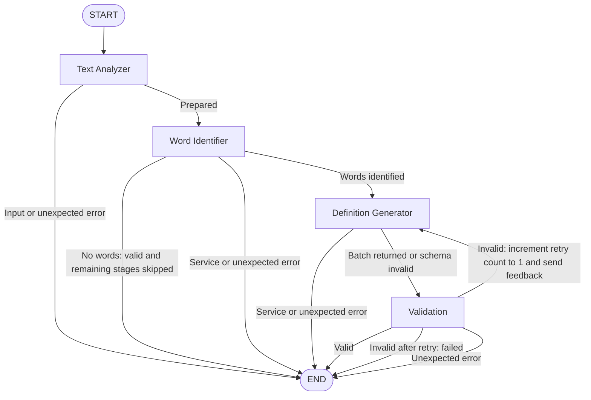

# Vocabulary Builder Agent

An academic Agentic AI project for learning vocabulary while reading. The planned
system will analyze a passage, select difficult words, generate contextual
definitions, validate the results, and export `Definitions.txt`.

**Phases 1–5 are implemented.** The app prepares a passage, identifies vocabulary,
generates contextual definitions and examples, validates results, and makes one
correction attempt when needed. It displays validated entries and creates a
previewable UTF-8 `Definitions.txt` download in memory. No API key is needed to
launch the UI; a key is required for analysis.

## Technologies

- Python 3.11+
- Streamlit for the interface, per-session state, preview, and download
- Pydantic for validated vocabulary output contracts
- python-dotenv for optional local environment configuration
- pytest and Streamlit AppTest for automated checks
- LangGraph StateGraph for agent orchestration and conditional retries
- Google Gemini API with the official google-genai SDK and Pydantic structured outputs
- UTF-8 TXT export; no database or server-side file storage

## Folder structure

The repository root is the `VocabularyBuilderAgent/` project directory (the local
checkout folder may have a different name).

```text
VocabularyBuilderAgent/
├── app.py
├── agents/
│   ├── __init__.py
│   ├── text_analyzer.py
│   ├── prompts.py
│   ├── word_identifier.py
│   ├── definition_generator.py
│   └── validator.py
├── workflows/
│   ├── __init__.py
│   └── vocabulary_workflow.py
├── services/
│   ├── __init__.py
│   ├── llm_service.py
│   └── file_service.py
├── models/
│   ├── __init__.py
│   └── vocabulary_model.py
├── utils/
│   ├── __init__.py
│   ├── helpers.py
│   └── config.py
├── tests/
│   ├── __init__.py
│   ├── conftest.py
│   ├── test_app.py
│   ├── test_identification.py
│   ├── test_llm_service.py
│   ├── test_workflow.py
│   └── test_file_service.py
├── .env.example
├── .gitignore
├── requirements.txt
└── README.md
```

`app.py` owns presentation and session state. `text_analyzer.py` validates input,
normalizes whitespace, and computes statistics. `word_identifier.py` coordinates
one structured request and deterministic validation through `validator.py`.
`prompts.py` contains selection criteria and instructions treating passage content
as untrusted data. `llm_service.py` owns SDK calls and sanitized error messages;
its `StructuredLLM` protocol allows replacement providers without UI changes.
`utils/config.py` loads environment settings and `helpers.py` counts words.

`models/vocabulary_model.py` preserves the complete Phase 1 vocabulary and analysis
models, with a shared difficulty enum accepting legacy lowercase values and
serializing title-case labels. Separate identification models omit definitions
and example sentences. `WordSelection` is the minimal LLM response;
`IdentificationResult` adds original text, selected difficulty, and locally
computed word count. An empty identified-words list is valid.

`definition_generator.py` produces a structured `DefinitionBatch` using the
existing `VocabularyEntry` model. `workflows/vocabulary_workflow.py` coordinates
the agents. `services/file_service.py` verifies the final workflow status and
revalidates the output before producing UTF-8 bytes in memory. It does not write
to disk or make API calls.

## Problem and objectives

Readers often meet unfamiliar words without an easy way to learn what they mean
in the passage they are reading. This project turns a short English passage into
a contextual vocabulary list. Its objectives are to select useful words at a
chosen proficiency level, explain each word in simple language, give a fresh
example sentence, verify that generated entries match the source, and let the
reader keep the validated list as a plain text file.

## Installation

Install Python 3.11 or newer and open a terminal in the project root.

Create a virtual environment:

```bash
python -m venv .venv
```

Activate it on Windows PowerShell:

```powershell
.\.venv\Scripts\Activate.ps1
```

Or on macOS / Linux:

```bash
source .venv/bin/activate
```

Install dependencies:

```bash
python -m pip install -r requirements.txt
```

To enable analysis, copy `.env.example` to `.env` and replace the placeholder
locally. Do not overwrite an existing `.env` containing your settings. In PowerShell:

```powershell
Copy-Item .env.example .env
```

On macOS / Linux, use `cp .env.example .env`. Never commit real keys. `.env` is
ignored by Git, and existing process environment variables take precedence.

```dotenv
GEMINI_API_KEY=your_actual_api_key
GEMINI_MODEL=gemini-2.5-flash
MAX_INPUT_CHARACTERS=5000
```

`GEMINI_MODEL` defaults to `gemini-2.5-flash` when unset. A replacement Gemini model
must support structured JSON outputs. The configured key must
have model access and available API quota. The positive integer input limit
applies to the original submission, including whitespace, before normalization.
Configuration errors and missing credentials are shown only when analyzing.

The service uses Google's official `google-genai` SDK with
`models.generate_content`, JSON response MIME type, and a Pydantic response schema,
as documented in the [Google Gen AI SDK guide](https://googleapis.github.io/python-genai/).
Raw response JSON is validated again locally with Pydantic. Incomplete, blocked,
or malformed outputs are never shown as successful vocabulary results.
Each nonempty successful analysis normally makes two requests: identification
and one batch definition request. A validation correction adds at most one more
definition request. No-word results use only identification. Each request has a
30-second timeout and one SDK attempt (no automatic network retries).
Input text is sent to Gemini only when you click Analyze for a new input/settings
combination. Downloading uses the validated in-memory result and makes no API call.
Quota, authentication, connectivity, and server errors use sanitized messages.
The application does not enable billing; free-tier availability and quota are
controlled by the Google project associated with your key.

## Run

```bash
streamlit run app.py
```

Open the local URL printed by Streamlit. Paste text, then click outside the text
area to update the word count (Streamlit commits text edits on blur, rather than
every keystroke). A word is a whitespace-separated token; this is not linguistic
tokenization. Choose Beginner, Intermediate (default), or Advanced, and at most
5, 10 (default), 15, or 20 vocabulary words. The level changes the selection
criteria; the maximum never requires the model to fill a quota.

Analyze shows a loading spinner, then actual workflow stage outcomes, summary
metrics, and vocabulary cards with definitions, context, and example sentences.
Results survive ordinary reruns; repeated Analyze clicks reuse the current
successful result. Editing the text or either setting invalidates results and
download content. Clear Text clears the passage, workflow state, results, feedback,
and download content while retaining selected settings. State is per browser
session and is not saved to disk. Errors permit a manual retry and never produce
fabricated vocabulary.

For nonempty validated results, the app prepares `Definitions.txt`, shows its
formatted contents in the “Definitions.txt Preview” section, and exposes the
“Download Definitions.txt” button. The download uses UTF-8 bytes, `text/plain`,
and Windows CRLF line endings. Streamlit handles the browser download; the app
does not create a permanent server-side file. Clicking Download does not rerun the
app or call the LLM. If no challenging words are selected, the app displays the
empty-result message and omits the preview and download button.

## Validation and limitations

The application rejects blank, non-word, and oversized input locally. Meaningful
English validation is a lightweight Latin-letter check, not language detection;
it cannot establish whether arbitrary prose is grammatical English.

The model selects words, but local code removes duplicates and absent word forms,
uses case-insensitive whole-token matching, restores the first occurrence's exact
spelling, sorts by passage order, and applies the maximum. Hyphenated and
apostrophe-containing words are treated as whole tokens; a singular form is not
accepted merely because a plural occurs. Model-provided context is replaced by a
span extracted from the original input. Basic punctuation/newline boundaries may
split abbreviations, so context can be a relevant span rather than a full sentence.

Difficulty is relative to the selected reader level. Selection quality and
educational relevance still depend on the model; deterministic checks guarantee
source grounding, not perfect pedagogical judgment. Prompt isolation reduces
instruction-injection risk but is not a guarantee of model behavior. There are
no tools for the model to execute. Refusals, incomplete responses, and malformed
structured output are errors. Malformed definition output is eligible for the
single correction attempt; identification failures terminate immediately. A valid
empty identification list displays the no-vocabulary state without generating definitions.

Structural validation does not prove that definitions are factually correct,
non-circular, or contextually appropriate, nor that examples are grammatical.
Those remain model responsibilities. Deterministic example checks only require
the selected word form and reject an example copied from the original passage.

## Phase 3 — Agentic AI Workflow

LangGraph makes the specialized stages, state updates, and correction decision
explicit in an executable graph. The compiled graph is created once at module
import and reused; each invocation gets fresh state and provider context. There
is no checkpointer, database, or global mutable agent data.

1. **Text Analyzer:** reuses `analyze_text` to validate input and prepare normalized
   text and word counts without an API request. Settings are checked before billing.
2. **Word Identifier:** uses `identify_prepared_text`, the shared Phase 2 logic.
   The original `identify_words` entry point remains available for identification
   alone. Empty selections terminate successfully, skipping the next two stages.
3. **Definition Generator:** makes one structured batch request for all selected
   words, asking for their contextual meanings and new, simple example sentences.
4. **Validation:** checks schema, completeness, exact spelling/context/difficulty,
   duplicates, unrelated words, count limits, and basic example constraints. It
   reorders valid entries into passage order without calling an LLM.

`VocabularyState` is a TypedDict containing original/cleaned text, difficulty,
maximum count, word statistics, identified words, generated definitions, validation
status/errors, generation errors, retry count, safe failure details, and actual
stage outcomes. Nodes return partial updates. Provider injection uses LangGraph
runtime context, not shared state; credentials are loaded only inside the service.



These are actual StateGraph conditional edges, including the Validation →
Definition Generator cycle. On the first invalid result, validation records errors
and increments `retry_count` from 0 to 1 before routing back. The generator receives
that feedback and returns a complete replacement batch. If it remains invalid,
status becomes `failed`, candidates are cleared, and a useful failure message and
validation details are returned. Valid results use status `valid`. API failures
(authentication, quota, connection, timeout, refusal, or incomplete response) end
execution immediately rather than triggering a formatting correction. A separate
graph recursion limit of 10 is a defensive bound, not the retry mechanism.

The UI shows only successful definitions. Stage outcomes are recorded by completed
node execution, not timers or simulated progress. `Pending` means a stage was not
reached; `Skipped` means no words required generation or validation. A generation
stage can complete even when its subsequent validation fails. Successful results
are reused on reruns; failed attempts can be manually rerun by clicking Analyze.

Configure `.env` as described above (`GEMINI_API_KEY`, `GEMINI_MODEL`, and optional
`MAX_INPUT_CHARACTERS`), then run `streamlit run app.py`. Run the offline suite with
`python -m pytest -q`. For non-UI use:

```python
from workflows.vocabulary_workflow import run_vocabulary_workflow

state = run_vocabulary_workflow(text, difficulty="Intermediate", max_words=10)
if state["validation_status"] == "valid":
    entries = state["generated_definitions"]
else:
    message = state["error_message"]
```

## Tests

```bash
python -m pytest -q
```

Tests cover startup without credentials, input limits, levels, deduplication,
word boundaries and forms, source context, ordering, maximum counts, empty and
malformed output, SDK errors, and UI state. Workflow tests exercise each terminal
path, successful and failed corrections, isolated state, individual nodes, and
failure suppression in the UI. The real SDK structured parser runs
against `httpx.MockTransport`; all real HTTP transport is blocked by an autouse
fixture and local `.env` loading is disabled. Tests never consume API credits.
Vocabulary examples are test fixtures only.

For an optional live smoke test, configure a valid key and model, run the app,
paste a short passage, and click Analyze once. Verify source words/context and
summary metrics. This sends billable API requests and is separate from pytest.
Automated mock tests verify the configured-model request path but cannot verify
your account's credentials, quota, or model access.

## Planned development phases

All five requested development phases are implemented.

1. **Foundation and initial UI:** modular structure, environment setup, input
   handling, output models, and baseline tests.
2. **AI integration (complete):** provider adapter, structured identification,
   contextual validation, difficulty settings, and results UI.
3. **Agent workflow (complete):** LangGraph orchestration, batch contextual
   definitions/examples, deterministic validation, and one controlled correction.
4. **Results and export (complete):** validated vocabulary preview and in-memory
   `Definitions.txt` download.
5. **Quality and completion (complete):** workflow, file formatting, session state,
   and end-to-end app behavior tested without live API requests.

## Example

Input: `The researcher showed perseverance while trying to decipher the message.`

With a Gemini key configured, output depends on the model and selected level.
A result may include a word, its contextual definition, the original sentence,
a new example sentence, and a difficulty label. The exported file includes a
title, level, entry count, numbered entries, and separators. Tests use mock
vocabulary only; the application does not hardcode words or definitions.

## Limitations

The model determines vocabulary selection and definition quality; schema and
source checks cannot prove a definition is factually accurate or an example is
grammatical. Text validation is a lightweight English-character check. Sentence
context extraction uses basic punctuation boundaries, and abbreviations may be
split. One definition correction is allowed; identification or service errors
end the run. A live API smoke test requires a valid key, quota, and model access.
The interface uses a slim frosted navigation rail, a centered glass input composer, a softly animated orb, and a refined export preview.

### Premium frontend

The Streamlit frontend includes a minimal icon sidebar, centered composer, live
word count, click-only difficulty and word-count controls, vocabulary cards,
workflow status, and a Definitions.txt preview and download surface. Analysis
runs only when the user presses the arrow button.
The IBM Plex Serif and Inter font files and licenses live in `ui/fonts/`; the
presentation shell is in `ui/presentation.py` and reusable responsive design
styles are in `ui/styles.css`. Layout controls adapt across desktop, tablet,
and mobile. Orb animation respects reduced-motion preferences.

### Gemini migration verification — 18 October 2026

- Installed official `google-genai` 2.31.0 in the existing virtual environment;
  removed the unused OpenAI SDK. Dependency checks pass.
- The service sends `response_json_schema` generated by Pydantic. This preserves
  strict object schemas without the unsupported `additional_properties` field
  encountered with Gemini's older `response_schema` transport.
- The requested default/template model remains `gemini-2.5-flash`. The live API
  reported that model unavailable to new users and recommended `gemini-3.8-flash`.
  This checkout's ignored `.env` therefore selects `GEMINI_MODEL=gemini-3.8-flash`.
  It has a [documented free tier](https://ai.google.dev/gemini-api/docs/pricing).
  No billing settings were changed. Actual account quota/billing remains controlled
  by Google; model discovery alone does not certify an account's billing tier.
- Offline tests cover SDK parsing over mocked HTTP, error sanitization, workflow
  branches, export bytes, and retry behavior without making live API requests.
- Live model discovery and structured vocabulary identification succeeded.
  Definition generation returned HTTP 503 (temporary overload); a final bounded
  attempt also returned overload. A complete live definitions/export run could
  not be confirmed at that time. The app now retries HTTP 503 twice with short
  backoff, then reports the overload without displaying incomplete results.
- The local Streamlit application starts and preserves all AI agent responsibilities.
